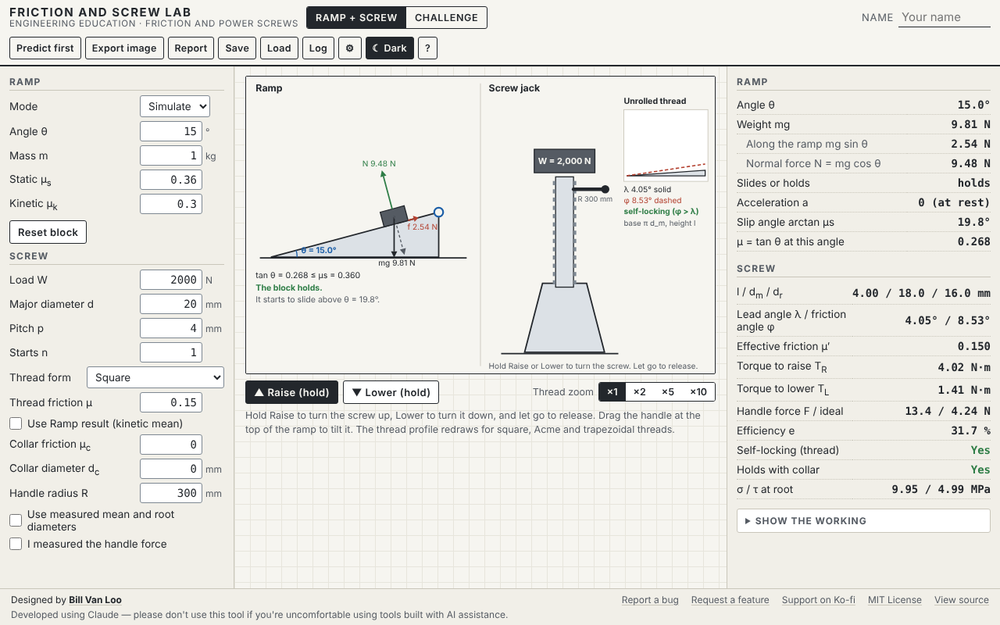

# Friction and Screw Lab

A browser tool in two linked parts. On the **Ramp**, students find a friction coefficient from the angle where a block slips, by simulation or from their own measurements. The **Screw jack** then uses that friction value to show the torque to raise and lower a load, the handle force, the efficiency, whether the screw holds by itself, and the stress at the root of the thread. A number students measured flows straight into a machine's behavior.

Part of **[Engineered by the Numbers](https://github.com/billvanloo/EngineeredByTheNumbers)**, a Principles of Engineering unit (module 2, the screw jack).



## Quick start

**Online:** enable GitHub Pages for this repo (Settings → Pages → Deploy from a branch → `main`, `/ (root)`) and share the URL.

**Offline:** download `index.html` and open it in any current browser. It's one self-contained file with no network calls, and works on a Chromebook.

## What students do

- **Ramp, simulate.** Drag the handle at the top of the ramp, or use the arrow keys on it. The block stays put until tan θ is more than μ<sub>s</sub>, then slides with a = g (sin θ − μ<sub>k</sub> cos θ). A force diagram shows the weight, its two components, the normal force and friction, with values.
- **Ramp, measure.** Type up to 20 measured slip angles (μ<sub>s</sub>) and steady-sliding angles (μ<sub>k</sub>). The tool shows each μ = tan θ on a dot plot, with the mean, the range and the sample standard deviation. **Send μ to Screw** copies the kinetic mean into the screw, labeled "from Ramp measurements". **Use Ramp result** keeps it linked as trials are added.
- **Screw jack.** Square, Acme or metric trapezoidal thread; load, diameter, pitch, starts, thread friction, collar friction and handle radius. Hold **Raise** (or ↑ with the jack selected) to turn, **Lower** (or ↓) to lower, and let go: a self-locking screw holds, and an overhauling one drops. The unrolled-thread triangle beside the jack is drawn at the true lead angle λ, with a dashed line at the friction angle φ and a zoom for small angles.
- **Measured handle force.** Enter a force measured on a real jack, and the tool finds the friction value that explains it, and the measured efficiency.
- **Predict first.** μ for a given slip angle, the torque to raise, the handle force, the efficiency, and whether the thread is self-locking stay hidden (along with the φ line) until the student predicts and presses Check. The jack won't turn until then. Every attempt goes to the prediction log.
- **Show the working.** Ramp and screw steps with numbers substituted and sources, including the tangent form T<sub>R</sub> = (W d<sub>m</sub>/2) tan(φ + λ) for square threads.
- **Challenges.** Three examples: a mystery surface with hidden μ values, a four-start screw that overhauls, and a double-thread jack held by its collar.
- **Saving and exports.** Save and Load design files; export a PNG (2×, ink on paper, with a caption); print a report with the measured trials; export the prediction log (JSON or CSV).

## Teacher notes

- **Challenges.** Replace the three examples with your own in Settings (a JSON list; the format is in the help panel and in [`ecosystem/schemas.md`](https://github.com/billvanloo/EngineeredByTheNumbers/blob/main/ecosystem/schemas.md)). A challenge can hide input values, set its own Match and Close bands, and require a checked prediction before the jack turns.
- **Measured μ.** Slip-angle measurements are good to one or two digits (OpenStax notes this). The tool sends the kinetic mean to the screw rounded to 3 significant figures and uses the sample standard deviation.
- **What's for show.** How fast an overhauling load drops is not computed; only whether it drops (the total lowering torque is negative) or holds.
- **Model choices to review.** These are in the curriculum repo's `QUESTIONS.md` and `ERRATA.md`:
  - Thread friction is accepted up to 1.0, not the spec's 0.5, so test case FS-10 (μ = 0.6) can be entered. The back-calculation already searches 0 to 1.
  - The torsional stress at the root uses the thread torque, not the collar torque (Q32).
  - The back-calculation holds the collar friction you entered (Q14).
- **Not in version 1:** ball screws, buckling of long screws (see the Truss Stress Visualizer), and wear life.

## How it connects to the other tools

| File | Direction |
|---|---|
| `prediction-log` JSON/CSV | **Out**, to the Prediction Log Collector |
| Measured μ | By hand: spec 05 asks capstone teams to measure the Conveyor Designer's bed friction with this ramp method |

The formats are documented in [`EngineeredByTheNumbers/ecosystem/schemas.md`](https://github.com/billvanloo/EngineeredByTheNumbers/blob/main/ecosystem/schemas.md).

## Development

```
node dev/test.js          # 94 checks: every spec test case FS-1 to FS-12, plus the targets, working and records
node dev/verify-html.js   # inline code in index.html matches dev/core.js and dev/vendor/; runs spec cases on it
node dev/e2e.js           # 152 browser checks in headless Chromium (needs Playwright, see below)
```

- **Where the code lives.** `dev/core.js` is the calculation layer: ramp, measured statistics, screw geometry and torques, back-calculation, the working steps and the predict-first targets. `dev/vendor/` holds shared code from the Engineered by the Numbers `ecosystem/`: the tool shell, statistics, plots, the animation clock, press-and-hold controls, the prediction log and the file schemas. Don't edit vendored files here. Change them in the EngineeredByTheNumbers repo and run its `scripts/sync-vendor.js`.
- **Changing the core.** Edit `dev/core.js`, run `node dev/test.js`, then `node dev/verify-html.js --fix` to copy it into `index.html`.
- **Animation in tests.** `dev/e2e.js` calls `Anim.manual(true)` and moves time with `Anim.advanceAll(seconds)`, so the release and sliding checks don't depend on machine speed.
- **Playwright for the e2e checks.** It isn't a project dependency. Once, from the repo root: `npm i --no-save playwright && npx playwright install chromium`. You can also set `CHROMIUM_PATH` to an installed Chromium.

The spec this tool was built from is in [`docs/spec.md`](docs/spec.md), with the shared conventions in [`docs/conventions.md`](docs/conventions.md).

This was built using Claude. Please don't use this tool if you have qualms about using code created with AI tools.
